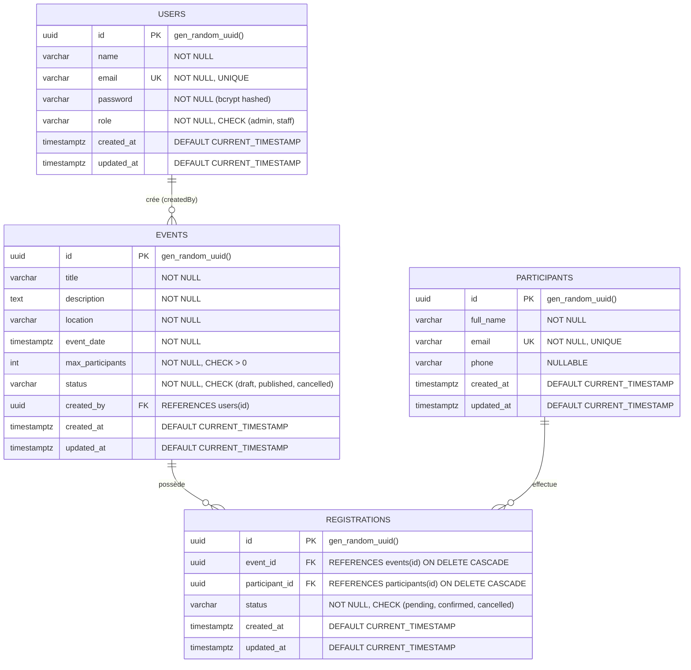

# EventHub — Document de Conception & Architecture

## 1. Présentation du Projet
**EventHub** est une application web d'entreprise bâtie sur la pile **PERN** (PostgreSQL, Express, React, Node.js) permettant une gestion centralisée des événements d'entreprise, des participants et de leurs inscriptions, assortie d'un tableau de bord de statistiques en temps réel.

---

## 2. Diagramme Entité-Relation (ERD)



---

## 3. Schéma Détaillé des Tables & Relations

### 3.1. Table `users`
Stocke les comptes des administrateurs et membres du personnel avec authentification sécurisée.
- `id` (UUID, Primary Key, `gen_random_uuid()`)
- `name` (VARCHAR(100), `NOT NULL`)
- `email` (VARCHAR(255), `NOT NULL`, `UNIQUE`)
- `password` (VARCHAR(255), `NOT NULL`, mot de passe haché par bcrypt)
- `role` (VARCHAR(20), `NOT NULL`, `CHECK (role IN ('admin', 'staff'))`, valeur par défaut : `'staff'`)
- `created_at` (TIMESTAMPTZ, `DEFAULT CURRENT_TIMESTAMP`)
- `updated_at` (TIMESTAMPTZ, `DEFAULT CURRENT_TIMESTAMP`)

### 3.2. Table `events`
Stocke les événements planifiés ou publiés.
- `id` (UUID, Primary Key, `gen_random_uuid()`)
- `title` (VARCHAR(200), `NOT NULL`)
- `description` (TEXT, `NOT NULL`)
- `location` (VARCHAR(255), `NOT NULL`)
- `event_date` (TIMESTAMPTZ, `NOT NULL`)
- `max_participants` (INTEGER, `NOT NULL`, `CHECK (max_participants > 0)`)
- `status` (VARCHAR(20), `NOT NULL`, `CHECK (status IN ('draft', 'published', 'cancelled'))`, défaut : `'draft'`)
- `created_by` (UUID, Foreign Key → `users(id)`, `ON DELETE RESTRICT`)
- `created_at` (TIMESTAMPTZ, `DEFAULT CURRENT_TIMESTAMP`)
- `updated_at` (TIMESTAMPTZ, `DEFAULT CURRENT_TIMESTAMP`)

### 3.3. Table `participants`
Stocke les personnes enregistrées dans l'annuaire de participants.
- `id` (UUID, Primary Key, `gen_random_uuid()`)
- `full_name` (VARCHAR(150), `NOT NULL`)
- `email` (VARCHAR(255), `NOT NULL`, `UNIQUE`)
- `phone` (VARCHAR(50), `NULL`)
- `created_at` (TIMESTAMPTZ, `DEFAULT CURRENT_TIMESTAMP`)
- `updated_at` (TIMESTAMPTZ, `DEFAULT CURRENT_TIMESTAMP`)

### 3.4. Table `registrations`
Assure la relation N-N entre événements et participants avec statut d'inscription.
- `id` (UUID, Primary Key, `gen_random_uuid()`)
- `event_id` (UUID, Foreign Key → `events(id)`, `ON DELETE CASCADE`)
- `participant_id` (UUID, Foreign Key → `participants(id)`, `ON DELETE CASCADE`)
- `status` (VARCHAR(20), `NOT NULL`, `CHECK (status IN ('pending', 'confirmed', 'cancelled'))`, défaut : `'pending'`)
- `created_at` (TIMESTAMPTZ, `DEFAULT CURRENT_TIMESTAMP`)
- `updated_at` (TIMESTAMPTZ, `DEFAULT CURRENT_TIMESTAMP`)
- **Contrainte d'unicité** : `CONSTRAINT uq_event_participant UNIQUE (event_id, participant_id)`

---

## 4. Contraintes & Règles Métier Obligatoires

1. **Publication Requise pour Inscription** :
   - Impossible d'inscrire un participant sur un événement dont le statut n'est pas `'published'`.
   - Contrôlé en amont dans la couche service/transaction PostgreSQL (`HTTP 400 - "Event is not published"`).
2. **Unicité des Inscriptions** :
   - Un participant ne peut pas s'inscrire 2 fois au même événement (`uq_event_participant` + gestion explicite de l'erreur `409 Conflict`).
3. **Gestion de Capacité (`max_participants`)** :
   - Lors de la création d'une inscription, vérification sous verrou (`FOR UPDATE`) du nombre d'inscriptions actives (`pending` + `confirmed`).
   - Si la capacité est atteinte, l'inscription est rejetée (`HTTP 400 - "Event is fully booked"`).
4. **Cascade d'Annulation d'un Événement** :
   - Lorsqu'un événement passe au statut `'cancelled'`, toutes ses inscriptions basculent automatiquement à `'cancelled'`.
   - Implémenté à la fois au niveau applicatif (transaction) et renforcé par un Trigger PostgreSQL (`trg_cancel_event_registrations`).

---

## 5. Index Recommandés pour la Performance

- `idx_events_status` sur `events(status)` (optimise les filtres `GET /api/events?status=...`)
- `idx_events_date` sur `events(event_date)` (optimise les tris et filtres par date)
- `idx_participants_search` sur `participants(email, full_name)` (optimise la recherche plein texte / ILIKE)
- `idx_registrations_event` sur `registrations(event_id)` (jointures et listes d'inscriptions)
- `idx_registrations_participant` sur `registrations(participant_id)` (consultation du dossier participant)
- `idx_registrations_created_at` sur `registrations(created_at)` (statistiques inscriptions du jour)
- `idx_registrations_status` sur `registrations(status)` (filtrage et compteurs)

---

## 6. Architecture Applicative

```
[ Frontend : React + Vite + Tailwind CSS ]
                  │
                  ▼ (Requêtes REST JSON avec JWT Bearer)
[ Backend : Node.js + Express + Zod + JWT ]
        ├─ Auth Controller / Middleware (Admin / Staff)
        ├─ Events Controller & Service
        ├─ Participants Controller & Service
        ├─ Registrations Controller & Service
        └─ Dashboard Controller & Service
                  │
                  ▼ (pg Pool / Transactions ACID)
[ Base de Données : PostgreSQL 16 ]
```
